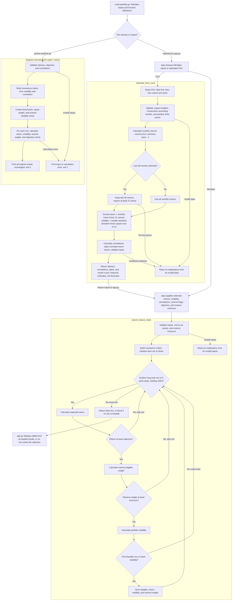

# Project 2 fund universe, monthly prices, and Streamlit preparation

Prepared with AI assistance on October 22, 2026, using the Meridian mandate in `Lab_13_Meridian_Mandate.md` and the numeric objective already in `portfolio.py`. The Lab 14 handout was not available locally, so the data conventions below are explicit and can be compared with its final instructions.

For the assignment's "Yours" column, this preparation applies the existing Meridian mandate to four selected ETFs. A separate personal mandate has not been supplied.

## Objective and one hard constraint

**Objective: target 6.5% annual nominal return, net of costs, evaluated over rolling five-year periods within the seven-year mandate.** This is the existing planning assumption of 2.5% CPI plus 4 percentage points. The 2.5% is an assumption, not a newly measured inflation rate. The original CPI + 4% objective changes if inflation changes. A target is not a guaranteed return.

**One hard constraint for this lab: allocate at least 3.0% to SGOV (`w_SGOV >= 0.03`).** Four quarterly distributions of $0.75 million require a $3 million reserve from the $100 million portfolio. SGOV serves as the short Treasury-bill reserve proxy. Requiring the entire reserve in this sleeve is a conservative modeling choice: the original case also permits other daily-liquid government securities. IEF is kept outside this lab's payout-reserve calculation to avoid relying on a longer-duration bond sleeve for near-term spending. An ETF proxy is not identical to holding cash or individual Treasury bills.

These are the selected objective and policy constraint for the lab. The other requirements in the Meridian mandate remain relevant to a full implementation. The grid-search results below evaluate this simplified lab problem. No trades have been made.

## Four-fund universe

| Ticker | Fund | Mandate role | Reason for inclusion | Fund-provider source |
|---|---|---|---|---|
| SGOV | iShares 0-3 Month Treasury Bond ETF | Cash and reserve | Short Treasury bills, used as the cash-like payout-reserve sleeve. | [iShares SGOV](https://www.ishares.com/us/products/314116/ishares-0-3-month-treasury-bond-etf) |
| IEF | iShares 7-10 Year Treasury Bond ETF | Government bonds | Treasury bond exposure corresponding approximately to the case's 10-year Treasury sleeve. A rolling ETF differs from one bond held to maturity. | [iShares IEF](https://www.ishares.com/us/products/239456/ishares-710-year-treasury-bond-etf) |
| BND | Vanguard Total Bond Market ETF | Fixed income | Broad U.S. investment-grade fixed income, representing the mandate's bond sleeve. | [Vanguard BND](https://advisors.vanguard.com/investments/products/bnd/vanguard-total-bond-market-etf) |
| VT | Vanguard Total World Stock ETF | Equity | Diversified global equity exposure, representing the mandate's growth sleeve. | [Vanguard VT](https://advisors.vanguard.com/investments/products/vt/vanguard-total-world-stock-etf) |

All four are ETFs. No money market fund is included. SGOV is the Treasury-bill proxy for cash, so its distribution-adjusted price history can represent the sleeve's earnings. The practice tickers BIL and LQD are not required selections; SGOV and BND fill those roles in this universe. BND also holds government-related bonds, so its exposure overlaps IEF; the estimated correlation matrix captures their historical co-movement.

The benchmark can be represented by 60% VT and 40% BND for comparison. That benchmark has no SGOV reserve and would fail the selected lab constraint. A benchmark is an evaluation reference, not a requirement to hold those exact weights.

## prices.csv and provenance

The file `prices.csv` contains columns `Date,SGOV,IEF,BND,VT`. Each value is a USD **Adjusted Close**, taken from the last trading day of the corresponding month. The date is that actual trading date, not an artificial calendar month-end. Prices retain source numeric precision.

The five-year measurement period is October 2021 through September 2026. The CSV contains **61 price observations per ticker**, from **2021-09-30 through 2026-09-30**: the September 2021 opening anchor plus 60 completed months. This yields exactly **60 monthly returns** using `P_t / P_(t-1) - 1`. Sixty price rows alone would provide only 59 returns. October 2026 is incomplete on the download date and is excluded.

| Ticker | Price source | Download date (America/Indianapolis) | Retrieved at (UTC) |
|---|---|---|---|
| SGOV | [Yahoo Finance history](https://finance.yahoo.com/quote/SGOV/history/) | 2026-10-22 | 17:39:32 |
| IEF | [Yahoo Finance history](https://finance.yahoo.com/quote/IEF/history/) | 2026-10-22 | 17:39:33 |
| BND | [Yahoo Finance history](https://finance.yahoo.com/quote/BND/history/) | 2026-10-22 | 17:39:33 |
| VT | [Yahoo Finance history](https://finance.yahoo.com/quote/VT/history/) | 2026-10-22 | 17:39:33 |

Downloads used Yahoo Finance's chart API with daily observations, `includeAdjustedClose=true`, and the field `indicators.adjclose[0].adjclose`. The last daily adjusted observation in each month was selected. Raw `Close` was not substituted. Adjusted prices account for distributions and splits and support total-return calculations; do not add distributions again when computing those returns. Fund expenses are reflected in fund performance, while additional advisory fees, taxes, and trading costs require separate treatment when assessing the net objective.

The download script is `download_fund_prices.py`. Raw daily JSON responses, exact query URLs, retrieval timestamps, and SHA-256 hashes are preserved in `outputs/fund_prices_sources/`. The per-ticker records are in `sources.json`. Adjusted historical series may change after later distributions or vendor corrections, so retain these source snapshots with this submission.

Validation checks: exactly four tickers; 61 consecutive monthly observations per fund; identical month-end trading dates; ascending unique dates; positive finite prices; no missing observations or filled/interpolated values. The exported CSV was checked against the validated source values.

### Yahoo Monthly history check

On October 22, 2026, Yahoo Finance's monthly chart feed (`interval=1mo`, with Adjusted Close requested) was checked separately for **SGOV, IEF, BND, and VT**. Each returned all 61 monthly observations from September 2021 through September 2026 with positive, finite adjusted prices. Verification responses and their exact URLs, timestamps, and hashes are saved in `outputs/fund_prices_sources/*_monthly_check.json` and `monthly_verification.json`.

The Yahoo Historical Data web pages were unavailable to the browsing tool, so this was an API verification rather than a visual inspection of the Monthly screen. The submission CSV retains the documented last-trading-day adjusted prices derived from Yahoo's daily data. It was independently checked against every original month-end source value. Yahoo's monthly bars may be dated at the beginning of the month; the CSV deliberately identifies the actual month-end observation date.

For a manual screen check, use the ticker's Yahoo history link above, choose a five-year time period and **Monthly**, and inspect **Adj Close**. The API verification establishes that all four funds have the required monthly adjusted history.

## Inputs estimated from five years of monthly prices

**Returns estimate label: historical sample estimate, not a forecast.** These calculations use the 60 monthly simple returns ending October 2021 through September 2026. They replace the training return, volatility, and correlation assumptions for the four-fund exercise. They do not replace the mandate's objective with a past return.

| Input | Four-fund exercise |
|---|---|
| Assets | SGOV, IEF, BND, VT |
| Return, volatility, correlation | Estimated from `prices.csv`, using 60 monthly returns |
| Objective | Target 6.5% annual nominal return net of costs, using the existing CPI planning assumption |
| Selected hard constraint | SGOV weight at least 3.0%, the conservative payout-reserve proxy described above |

For each fund, calculate monthly returns as `r_t = P_t / P_(t-1) - 1`. The return input is the **arithmetic monthly sample mean multiplied by 12**. Volatility is the **sample standard deviation of monthly returns multiplied by sqrt(12)**, using `n - 1` in the variance denominator. Correlations are Pearson sample correlations between the funds' monthly returns, not between their price levels. Annualized covariance is monthly sample covariance multiplied by 12. This volatility/covariance scaling assumes no serial correlation between monthly returns.

| Ticker | Historical arithmetic return (annualized) | Historical volatility (annualized) | Historical CAGR |
|---|---:|---:|---:|
| SGOV | 3.72% | 0.50% | 3.78% |
| IEF | -1.79% | 7.65% | -2.06% |
| BND | -0.42% | 6.45% | -0.63% |
| VT | 11.90% | 14.92% | 11.35% |

CAGR is shown separately as the realized compound growth rate, calculated as `(P_last / P_first)^(12 / 60) - 1`. It is not the arithmetic return input. All estimates use unrounded price and return values; the displayed figures are rounded. Historical fund performance embeds fund expenses but excludes additional advisory fees, taxes, and trading costs, so comparing these inputs directly with the net-of-cost target requires an explicit treatment of those additional costs.

Monthly return correlation matrix:

| Ticker | SGOV | IEF | BND | VT |
|---|---:|---:|---:|---:|
| SGOV | 1.0000 | 0.1956 | 0.2586 | 0.1886 |
| IEF | 0.1956 | 1.0000 | 0.9804 | 0.6281 |
| BND | 0.2586 | 0.9804 | 1.0000 | 0.7207 |
| VT | 0.1886 | 0.6281 | 0.7207 | 1.0000 |

A five-year average describes this sample. Future returns, volatility, and correlations can differ. In a later model, label the input "Historical annualized mean return" rather than presenting it as an independently justified forecast of expected return. Keep the 6.5% objective labeled "Mandate target".

Reproduce the estimates from the saved prices with:

```powershell
.\.venv\Scripts\python.exe fund_estimates.py
```

The calculation saves unrounded estimates, covariance, correlation, and the input CSV's SHA-256 hash in `outputs/fund_estimates.json`. The estimator rejects missing, nonpositive, or nonfinite prices, duplicate/out-of-order dates, and gaps in the monthly series.

## Meridian training reproduction and engine check

Verified through the Streamlit app's displayed tables and metrics using AppTest. The following results were calculated by the imported `portfolio.py` engine, not entered into the app as answers. The objective stayed at **6.50%**, the reserve minimum at **3.00%**, and bills and the 10-year note were reserve-eligible.

| Run | Bills | 10-year note | IG bonds | Equity | Expected annual return | Annual volatility |
|---|---:|---:|---:|---:|---:|---:|
| As loaded | 0.00% | 20.00% | 25.00% | 55.00% | 6.51% | 9.44% |
| Equity estimate reduced from 8.00% to 7.00% | 0.00% | 10.00% | 10.00% | 80.00% | 6.53% | 12.94% |
| IG-equity correlation temporarily changed to 0.50 | 0.00% | 40.00% | 0.00% | 60.00% | 6.52% | 9.73% |

**Largest weight change after the one-point equity-estimate reduction: 25.00 percentage points.** The equity weight rises from 55% to 80% even though its assumed return falls, because the search needs more equity to maintain the same return target. Estimated volatility rises from 9.44% to 12.94%. This is substantial sensitivity to one estimated input.

For the engine check, both IG-equity correlation entries were changed in the saved `portfolio.py` file. A fresh app-test process then displayed the specified 0 / 40 / 0 / 60 answer. The source file was restored byte for byte, returning both entries to **0.25**. The original command-line report also matched its saved output byte for byte. `app.py` imports the search and estimator from `portfolio.py`; it contains no second implementation of portfolio return, covariance, volatility, or the allocation search. The actual browser refresh was not inspected because computer use could not reliably identify the browser URL.

Detailed verification records are saved in `outputs/portfolio_engine_proof.json`.

## Project 2 app results: all months versus last 36 months

Recorded October 22, 2026. Uploaded the saved `prices.csv` through the app's file uploader using Streamlit's AppTest runner, set the controls, read the all-month result, and then switched to the last 36 months. Both displayed answers were checked against `portfolio.py`. This verifies the app interaction and engine outputs without claiming a manual browser inspection.

Settings held fixed for both runs:

- **Annual return objective: 6.50%.** It was not lowered to obtain a feasible mix.
- **Reserve minimum: 3.00%.** SGOV was ticked as reserve-eligible; IEF, BND, and VT were unticked, following the selected Project 2 reserve rule.
- Expected-return boxes retained the historical estimates produced by the selected window, with no manual overrides.
- Fully invested, long-only weights in 5-percentage-point steps. The as-loaded comparison retained all months when the switch changed.

| Run | Monthly returns used | SGOV | IEF | BND | VT | Estimated annual return | Annual volatility | Reserve-eligible weight |
|---|---:|---:|---:|---:|---:|---:|---:|---:|
| All months | 60 | 65.00% | 0.00% | 0.00% | 35.00% | 6.58% | 5.29% | 65.00% |
| Last 36 months | 36 | 85.00% | 0.00% | 0.00% | 15.00% | 6.81% | 1.79% | 85.00% |

All months uses returns ending October 2021 through September 2026, calculated from prices dated **2021-09-30 through 2026-09-30**. The last-36-month run uses returns ending October 2023 through September 2026, calculated from 37 prices dated **2023-09-29 through 2026-09-30**.

**Largest weight change: 20.00 percentage points.** SGOV rises from 65% to 85%, while VT falls from 35% to 15%. IEF and BND remain at zero. Both runs produce a mix meeting the modeled return and reserve thresholds; neither reports "no mix meets the objective."

These return figures are **historical annualized arithmetic estimates, not forecasts**. Additional advisory fees, taxes, and trading costs are excluded. The change in the selected mix reflects sensitivity to the estimation window, not a demonstrated improvement in future performance. Unrounded engine outputs, the CSV hash, and the displayed results are saved in `outputs/project2_window_comparison.json`.

## The call

**Pilot** the all-month mix of **65% SGOV and 35% VT** as the Project 2 starting allocation. Switching to the last 36 months moves **20 percentage points** from equity into reserves. That sensitivity supports a pilot rather than immediate adoption. Adopt only after the CIO defines S9's loss test and the allocation passes that agreed test. S9 is inherited from the working Meridian mandate; this preparation does not claim the CIO has already supplied the missing definition.

## Fresh eyes: partner attack and response

**Pending: the actual partner's attack and the response.** No partner challenge for this exercise has been supplied or recorded. The window comparison above completes the quantitative stability exercise, but does not by itself complete this rubric criterion.

To complete this section, record the partner's name, their specific challenge to this allocation or its assumptions, the response supported by a check or evidence, and whether that challenge changes the pilot decision. Preserve any resulting test settings and result. An AI-generated challenge must be labeled as such and cannot be represented as an actual partner's contribution.

## portfolio.py flowchart

Running `portfolio.py` directly produces the original three-portfolio report. Importing it from `app.py` makes its inputs and functions available without printing that report. The CSV estimator returns historical inputs to the app; the app then calls the search with the selected inputs and controls.



Both the original report and the search reuse `build_covariance_matrix()`, `portfolio_expected_return()`, `portfolio_volatility()`, `reserve_eligible_weight()`, and `meets_objective()`. The search finds the lowest volatility on its 5-percentage-point grid. The CSV estimator initially sets reserve eligibility to false; the app supplies the editable reserve flags before searching.

## Thursday app preparation

Run the Meridian training case first, using its supplied four-sleeve return, volatility, and correlation assumptions. Then run the Project 2 ETF universe above using the historical estimates from `prices.csv`. Keep the training assumptions separate from the estimated fund inputs.

The implemented optimization in `app.py` calls `portfolio.py` to find the lowest modeled volatility on a 5-percentage-point grid of long-only, fully invested mixes meeting the numeric return target and reserve requirement. The working Project 2 target is 6.5% and the selected reserve constraint is `w_SGOV >= 0.03`. The app labels historical estimates and excluded additional costs, and reports "no mix meets the objective" if no grid allocation is feasible.

For the preview's "one-point change," raising the annual return target from **6.5% to 7.5%** is one possible test. The instructor subsequently supplied a specific Meridian test: reduce the equity return estimate from 8% to 7%. That app test matched the specified weights and 25-percentage-point largest change. A temporary change of the IG-equity correlation to 0.50 in both source cells also matched the specified app answer, and the original 0.25 values were restored. Those verification records are in `outputs/portfolio_engine_proof.json`. The separate Project 2 window comparison is recorded above.

## Streamlit installation and demo

Installed **Streamlit 1.66.1** into the existing project `.venv` with Python 3.14. `pip check` reported no broken requirements. Installation followed the [official Streamlit installation page](https://docs.streamlit.io/get-started/installation/command-line).

From the project folder in PowerShell, check the installation with:

```powershell
.\.venv\Scripts\python.exe -m streamlit --version
```

The official Hello demo was started with:

```powershell
.\.venv\Scripts\python.exe -m streamlit hello --server.headless true --server.address 127.0.0.1 --server.port 8501 --browser.gatherUsageStats false
```

Open [the local demo](http://127.0.0.1:8501) while the server is running. The server reported successful startup on October 22, 2026, and its health endpoint returned HTTP 200 with `ok`. The official demo script also executed without app exceptions using Streamlit's AppTest runner. Browser automation was unavailable in this session, so browser appearance was not visually inspected. To start the demo later with automatic browser opening, run:

```powershell
.\.venv\Scripts\python.exe -m streamlit hello --browser.gatherUsageStats false
```

Press `Ctrl+C` in the terminal running the server to stop it. Using the explicit project interpreter avoids requiring a global `python` or `streamlit` command on PATH.

## Basic concepts through Data flow

Read the official [Basic concepts](https://docs.streamlit.io/get-started/fundamentals/main-concepts), including its Development flow and Data flow sections. A normal Python script becomes an app when it calls Streamlit commands and is launched with `streamlit run`. Streamlit starts a local server and displays the script's text, tables, plots, and widgets in a browser. Saving source changes can trigger a rerun during development.

**What happens to my script each time someone moves a control?** By default, Streamlit reruns the entire script from top to bottom using the control's updated value. Calculations and displayed results are rebuilt for that user's session. For example, changing a reserve-weight slider makes the script re-read the weight, recalculate the reserve check, and redraw the result.

Ordinary local variables are assigned again on each run. Use `st.session_state` when a value must persist between reruns, and `@st.cache_data` for expensive data loads or calculations so unchanged inputs can reuse cached results. A widget callback runs before the rest of the script. Forms can batch inputs until submission, and fragments can limit a rerun to part of an app. These are exceptions to the default full-script behavior.
